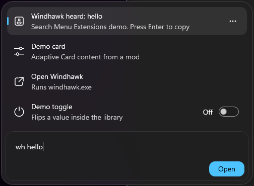
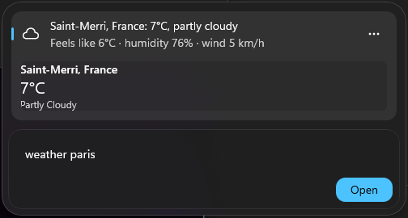

> **Updated for Build 26320.9876 (Windows 11 Insider Beta).** Insider builds change quickly; newer builds may break this.

# New Windows Search Extensions (Windhawk library mod)

**For the NEW Windows 11 Insider search box only** (the compact "composer" search,
`shellhost.exe loadComponent SystemComposerControl`). Not classic Start menu search, not the old
`SearchHost.exe` taskbar flyout, not Windows 10.

Lets other Windhawk mods, scripts and programs add native results, actions, toggles and cards to it.

## Files

- `search-menu-extensions.wh.cpp` is the **mod to install**. It's generated by `build.sh`, so edit `src/` instead.
- `src/head.cpp` holds the Windhawk header, readme and settings. `src/body.cpp` is the core (ABI, async ops, items, catalog hooks). `src/body2.cpp` has the C API, pipe server, demo and lifetime code.
- `src/pal_abi_min.h` holds the raw ABI for `Windows.UI.Palettes`, generated by `src/gen_abi.py` from `winmdidl` output of `C:\Windows\System32\WinMetadata\Windows.UI.winmd`.
- `examples/search-kill-process.wh.cpp` is an in-process client mod ("kill <name>").
- `examples/weather_client.py` is an out-of-process pipe client ("weather <city>", wttr.in).
- `test/` has the harness: `inject.exe` loads `out/wse-test.dll` (the mod source wrapped with `src/test_shim.h` and `src/test_main.cpp`, logging to `%TEMP%\wse-test.log`) into the composer; `uiasearch.ps1` drives search through UI Automation; `restart-inject.ps1` restarts the composer and race-injects.

## How it works

- Every native search source is a `Windows.UI.Palettes` extension (`PaletteCatalog.GetPalettes()` lists 17: Apps, Files, Settings, WinAct, Store...).
- The mod patches vtables inside `OSClient.API.dll` (no symbols needed):
  - `IPaletteCatalogStatics` slots 10–12 (Open*) and 14 (TryGetItem)
  - `IPaletteCatalog` slots 6–9 (GetPalette, GetPalettes, add/remove Changed)
  - `IPaletteCatalogPrivate` (`{dcaa0cae-03e9-40b2-9496-676cd0568278}`) slots 7–9 (GetOrderedSourceDefinitions, IsEnabled, IsUserDisabled)
- For each provider it appends its own `IPaletteExtensionDefinition`, with kinds `QueryResult.SystemComposer` + `BuiltIn`. RunUX then calls `CreateExtension` and `ExecuteQueryAsync`.
- Items are real `PaletteItem`s from a `PaletteItemFactory`, unmarshalled from a PropertySet `{ExtensionId}` (`IValueUnmarshalByPropertySet` `{ecabe149-...}`).
- Captured `Changed` handlers let it refresh RunUX when providers come and go.

## Verified (8 Nov 2026, build 26320.9876)

- Demo items rank and render natively: icons, subtitles, tags.
- A copy action works through `PaletteDelegateInvoker`, and a run action launches the program.
- A native toggle switch round-trips its state.
- An Adaptive Card renders under the selected row.
- Pipe client: live weather card. In-process client: kill process. Both picked up without a restart.
- Clean unload: providers removed, composer stays alive.

## Known limits

- Card `Action.Submit` buttons don't call back in the inline preview (RunUX: "Slot previews do not support card actions").
- Windows reads providers at composer start. If the mod is enabled late, it restarts the composer (setting `restartIfLate`).

## License

MIT, see `LICENSE`. Agents working on this repo: see `AGENTS.md`.
